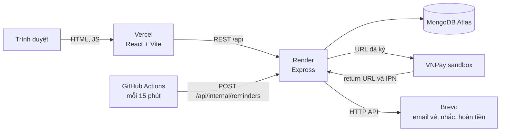
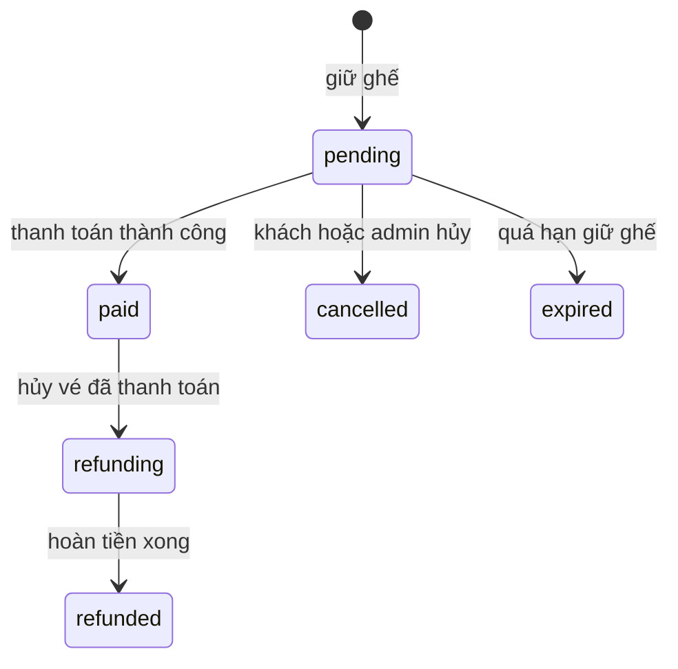

# Denim Cinema

Website đặt vé xem phim đầy đủ luồng thật: chọn phim hoặc rạp, chọn ghế, giảm giá, thanh toán qua cổng VNPay (sandbox), nhận vé điện tử có mã QR qua email, soát vé tại rạp, hủy vé và hoàn tiền. Có khu vực quản trị riêng cho admin.

Xây dựng bằng **React + Express + MongoDB**, chạy thật trên Vercel, Render và MongoDB Atlas.

**Bản chạy thử:** https://denimcinema.vercel.app

> Server chạy trên Render bản miễn phí nên "ngủ" sau ~15 phút không có người dùng: lần mở đầu tiên có thể chậm vài chục giây. Thanh toán dùng cổng **sandbox** của VNPay nên không mất tiền thật.

## Tính năng

**Khách hàng**
- Đăng ký, đăng nhập bằng số điện thoại hoặc email; phiên đăng nhập tự gia hạn (access token ngắn hạn + refresh token xoay vòng).
- Xem phim đang chiếu và sắp chiếu, trang chi tiết có trailer, lịch chiếu theo ngày và rạp.
- Chọn theo rạp: danh sách rạp theo thành phố, lịch chiếu từng ngày, số ghế còn trống của mỗi suất.
- Đánh giá và nhận xét phim (chỉ người đã xem, một đánh giá mỗi phim), điểm trung bình trên thẻ phim.
- Đặt vé: sơ đồ ghế theo thời gian thực, tối đa 8 ghế mỗi đơn, giữ ghế 10 phút để thanh toán.
- Mã giảm giá (phần trăm hoặc số tiền cố định) với báo giá tức thì.
- Thanh toán VNPay, trang kết quả giải thích rõ lý do khi giao dịch không thành công.
- Vé điện tử có mã QR, email vé tự gửi sau khi thanh toán, nhắc giờ chiếu trước suất chiếu vài giờ (tắt được trong Hồ sơ).
- Tự hủy vé đã thanh toán trước giờ chiếu và nhận hoàn tiền; theo dõi trạng thái hoàn tiền.
- Hồ sơ cá nhân, đổi mật khẩu.

**Quản trị (admin)**
- Tổng quan: doanh thu theo ngày, số vé, phim bán chạy, tình trạng đơn.
- Quản lý phim, rạp, phòng chiếu, suất chiếu (chặn trùng lịch trong cùng phòng), mã giảm giá, người dùng và phân quyền.
- Đơn đặt vé: tìm kiếm, lọc, xem lịch sử thanh toán, hủy đơn chưa thanh toán, hủy và hoàn tiền đơn đã thanh toán.
- Soát vé tại rạp: quét mã QR bằng camera hoặc nhập mã, mỗi vé chỉ vào được một lần.
- Hoàn tiền: danh sách khoản chưa xong, thử lại, đánh dấu hoàn thủ công.

Giao diện thiết kế ưu tiên điện thoại (kiểm tra ở 375px) và dùng tốt trên máy tính.

## Công nghệ

| Phần | Công nghệ |
|---|---|
| Giao diện | React 19, React Router 7, Tailwind CSS 4, Vite, Axios, `qrcode.react`, `qr-scanner` |
| Server | Node.js (>= 20), Express 5, Mongoose 9, JWT, bcryptjs, helmet, express-rate-limit |
| Cơ sở dữ liệu | MongoDB (Atlas khi deploy) |
| Thanh toán | VNPay sandbox (có cổng giả lập khi phát triển) |
| Email | Brevo (gọi qua HTTP) |
| Lịch chạy nền | GitHub Actions gọi server mỗi 15 phút |
| Triển khai | Vercel (giao diện), Render (server), MongoDB Atlas |

## Kiến trúc



Vòng đời một đơn đặt vé:



## Những điểm kỹ thuật đáng chú ý

- **Không bán trùng ghế:** giữ ghế bằng một lệnh cập nhật nguyên tử có điều kiện; hai người bấm cùng lúc thì chỉ một người thắng.
- **Một đơn chỉ đi một trong các đường:** các bước chuyển trạng thái (`pending → paid | cancelled | expired`, `paid → refunding`, soát vé) đều là lệnh nguyên tử có điều kiện, nên một đơn không thể vừa được thanh toán vừa bị nhả ghế, hay vừa được hoàn tiền vừa được vào rạp.
- **Thanh toán đáng tin:** chữ ký VNPay và số tiền được kiểm tra ở cả return URL lẫn IPN; kết quả chỉ ghi một lần dù hai đường về cùng lúc hoặc IPN bị gọi lặp. Trang kết quả luôn đọc trạng thái thật từ database.
- **Tiền và email không bị xử lý hai lần:** hoàn tiền, email vé, email nhắc và lượt dùng mã giảm giá đều dùng cơ chế "giành quyền" nguyên tử; thử lại cùng lúc chỉ gửi một yêu cầu.
- **Hoàn tiền thận trọng:** khi cổng thanh toán không trả lời, khoản hoàn giữ ở trạng thái "chưa rõ" thay vì đoán; admin kiểm tra rồi thử lại hoặc đánh dấu hoàn thủ công.
- **Phiên đăng nhập:** access token 15 phút, refresh token 30 ngày chỉ lưu dạng băm, xoay vòng mỗi lần dùng, phát hiện dùng lại token cũ thì thu hồi cả chuỗi phiên; đổi mật khẩu đăng xuất mọi thiết bị.
- **Bảo mật:** giới hạn số request theo IP và theo tài khoản (đăng nhập, đặt vé, thanh toán, email, hoàn tiền...), `helmet`, CORS theo địa chỉ giao diện, kiểm tra cấu hình lúc khởi động (từ chối khóa JWT mẫu, thiếu biến bắt buộc), dữ liệu người dùng được escape trong email.
- **Chạy được trên hạ tầng miễn phí:** Render chặn SMTP nên email gửi qua HTTP API; Render "ngủ" nên việc nhắc giờ chiếu được gọi từ GitHub Actions.

## Chạy ở máy

Cần Node.js >= 20 và một MongoDB (máy hoặc Atlas).

```bash
# 1. Cài thư viện
cd server && npm install
cd ../client && npm install

# 2. Cấu hình server
cd ../server
cp .env.example .env    # rồi sửa MONGO_URI và JWT_SECRET
```

Tạo khóa đăng nhập mới (đừng dùng lại giá trị mẫu):

```bash
node -e "console.log(require('crypto').randomBytes(48).toString('hex'))"
```

Chạy hai phần, mỗi phần một cửa sổ terminal:

```bash
cd server && npm run dev    # http://localhost:5000
cd client && npm run dev    # http://localhost:5173 (tự chuyển /api sang server)
```

Dữ liệu ban đầu: đăng ký một tài khoản trên web, cấp quyền admin bằng lệnh dưới, rồi vào mục **Quản trị** để thêm phim, rạp, phòng chiếu và suất chiếu.

```bash
cd server
npm run make-admin -- email-cua-ban@example.com
```

Khi phát triển, thanh toán dùng **cổng giả lập** (trang `/pay/:id` có nút "thanh toán thành công/thất bại"), không cần tài khoản VNPay. Muốn xem email mà không gửi thật, đặt `EMAIL_PROVIDER=console` để chỉ ghi log.

Kiểm tra mã nguồn giao diện: `cd client && npm run lint` và `npm run build`.

## Biến môi trường

Server (`server/.env`, mẫu ở `server/.env.example`):

| Biến | Bắt buộc | Ý nghĩa |
|---|---|---|
| `MONGO_URI` | có | Chuỗi kết nối MongoDB |
| `JWT_SECRET` | có | Khóa ký đăng nhập, chuỗi ngẫu nhiên dài từ 32 ký tự |
| `CLIENT_URL` | production | Địa chỉ giao diện (CORS), không có `/` ở cuối |
| `PORT` | không | Mặc định 5000 |
| `NODE_ENV` | không | Đặt `production` khi deploy |
| `TRUST_PROXY` | khi deploy | Số proxy đứng trước server (Render: `1`) |
| `HOLD_MINUTES` | không | Số phút giữ ghế chờ thanh toán (mặc định 10) |
| `RATE_LIMIT_OFF` | không | `true` để tắt giới hạn request khi dev |
| `PAYMENT_GATEWAY` | không | `mock` (mặc định) hoặc `vnpay` |
| `ALLOW_MOCK_PAYMENT` | không | `true` bật cổng giả lập ở production (chỉ cho bản demo không thu tiền) |
| `VNPAY_TMN_CODE`, `VNPAY_HASH_SECRET`, `SERVER_URL` | khi dùng VNPay | Thông tin tài khoản VNPay và địa chỉ công khai của server |
| `VNPAY_URL`, `VNPAY_REFUND_URL` | không | Ghi đè địa chỉ thanh toán và hoàn tiền (mặc định sandbox) |
| `VNPAY_REFUND_API` | không | `off` = không gọi API hoàn tiền của VNPay, chuyển sang hoàn thủ công |
| `EMAIL_PROVIDER` | không | `brevo` (gửi thật) hoặc `console` (ghi log); bỏ trống = tắt email |
| `BREVO_API_KEY`, `MAIL_FROM_EMAIL`, `MAIL_FROM_NAME` | khi dùng Brevo | Khóa API và người gửi đã xác minh |
| `REFUND_CUTOFF_HOURS` | không | Khách tự hủy được đến trước giờ chiếu bao nhiêu giờ (mặc định 2) |
| `REMINDER_HOURS` | không | Nhắc giờ chiếu trước bao nhiêu giờ (mặc định 3) |
| `CRON_SECRET` | không | Khóa (>= 24 ký tự) để GitHub Actions gọi việc nhắc giờ chiếu |

Giao diện (`client/.env`): chỉ cần `VITE_API_URL` khi deploy (địa chỉ server, không có `/api`). Chạy ở máy thì để trống.

## API tóm tắt

Tất cả nằm dưới `/api`. Quyền: công khai, đăng nhập, hoặc admin.

| Nhóm | Đường dẫn chính |
|---|---|
| Sức khỏe | `GET /health` |
| Tài khoản | `POST /auth/check`, `/auth/register`, `/auth/login`, `/auth/refresh`, `/auth/logout`, `/auth/change-password`; `GET /auth/me`; `GET, PATCH /auth/profile` |
| Phim | `GET /movies`, `/movies/:id`; `GET /movies/:id/reviews`; thêm, sửa, xóa (admin) |
| Đánh giá | `GET /movies/:id/reviews/me`, `PUT /movies/:id/reviews`, `DELETE /reviews/:id` |
| Rạp, phòng | `GET /cinemas` (kèm `?withUpcoming=1`), `GET /cinemas/:id/schedule?date=`, `GET /rooms`; thêm, sửa, xóa (admin) |
| Suất chiếu | `GET /showtimes`, `/showtimes/:id`, `/showtimes/:id/seats`; thêm, sửa, xóa (admin) |
| Đặt vé | `POST /bookings`, `/bookings/quote`; `GET /bookings/mine`, `/bookings/:id`; `POST /bookings/:id/cancel`, `/refund`, `/email` |
| Thanh toán | `POST /payments`; `GET /payments/:id`; `GET /payments/vnpay/return`, `/vnpay/ipn` |
| Quản trị | `/admin/stats`, `/admin/bookings`, `/admin/users`, `/admin/coupons`, `/admin/refunds`, `/admin/tickets/:code` (xem, soát vé) |
| Nội bộ | `POST /internal/reminders` (cần `CRON_SECRET`) |

## Triển khai (Atlas + Render + Vercel)

Làm theo thứ tự: database → server → giao diện → nối lại CORS.

### 1. MongoDB Atlas
- Network Access: thêm `0.0.0.0/0` (Render bản miễn phí không có IP cố định).
- Lấy chuỗi kết nối (`mongodb+srv://...`) cho `MONGO_URI`.

### 2. Server trên Render
- New → Blueprint, chọn repo này (file `render.yaml` ở thư mục gốc đã có sẵn cấu hình), hoặc tạo Web Service thủ công: Root Directory `server`, Build `npm install`, Start `npm start`, Health Check `/api/health`.
- Đặt các biến trong bảng ở trên. Tối thiểu: `NODE_ENV=production`, `MONGO_URI`, `JWT_SECRET` (chuỗi ngẫu nhiên mới, Blueprint tự sinh), `CLIENT_URL` (địa chỉ Vercel), `TRUST_PROXY=1`, `PAYMENT_GATEWAY=vnpay` cùng `VNPAY_TMN_CODE`, `VNPAY_HASH_SECRET`, `SERVER_URL` (địa chỉ công khai của server Render, VNPay dùng để đưa khách quay về).
- Tạo tài khoản admin: dùng tab Shell của Render hoặc chạy ở máy với `MONGO_URI` của Atlas: `npm run make-admin -- email@cua-ban.com`.

### 3. Giao diện trên Vercel
- Import repo, Root Directory `client` (Vite được nhận diện tự động).
- Biến môi trường: `VITE_API_URL` = địa chỉ server Render (không có `/api`, không có `/` ở cuối).
- `client/vercel.json` đã có rewrite để mở thẳng các đường dẫn như `/tickets/...` không bị 404.

### 4. Nối lại
- Đặt địa chỉ Vercel vào `CLIENT_URL` trên Render (server tự khởi động lại).
- Đổi `VITE_API_URL` thì phải Redeploy giao diện, vì biến này được ghi vào bản build.

### 5. Gửi email (tùy chọn)
- Render bản miễn phí **chặn cổng SMTP** (25/465/587), nên dùng dịch vụ gửi qua HTTP. Dự án dùng [Brevo](https://www.brevo.com) (gói miễn phí 300 email/ngày).
- Trong Brevo: *Settings → Senders* thêm và xác minh email người gửi, rồi *SMTP & API → API Keys* tạo khóa.
- Trên Render: `EMAIL_PROVIDER=brevo`, `BREVO_API_KEY`, `MAIL_FROM_EMAIL` (đúng email vừa xác minh), tùy chọn `MAIL_FROM_NAME`.
- Không đặt `EMAIL_PROVIDER` thì tính năng email tắt, giao diện không hứa "đã gửi".

### 6. Hủy vé và hoàn tiền
- Khách tự hủy vé đã thanh toán được đến trước giờ chiếu `REFUND_CUTOFF_HOURS` giờ (mặc định 2), vé chưa quét, và được hoàn đúng số tiền đã trả. Admin hủy và hoàn được cho mọi vé chưa quét. Lượt dùng mã giảm giá không được trả lại.
- API hoàn tiền của VNPay cần VNPay bật cho tài khoản và thường đòi đăng ký IP của server (Render bản miễn phí không có IP cố định). Khi chưa dùng được, đặt `VNPAY_REFUND_API=off`: hệ thống không gọi VNPay mà đưa khoản hoàn sang "cần hoàn thủ công" ở mục **Hoàn tiền** của admin (hoàn trên cổng VNPay rồi đánh dấu). Đặt `on` (mặc định) khi VNPay đã bật API.

### 7. Nhắc giờ chiếu
- Workflow `.github/workflows/reminders.yml` gọi `POST /api/internal/reminders` mỗi 15 phút (lời gọi cũng đánh thức server đang ngủ). Cách bật:
  1. Trên Render đặt `CRON_SECRET` = chuỗi ngẫu nhiên dài từ 24 ký tự.
  2. Trên GitHub: *Settings → Secrets and variables → Actions*, tạo `CRON_SECRET` (cùng giá trị) và `API_URL` (địa chỉ server Render, không có `/api`, không có `/` ở cuối).
  3. Vào tab *Actions → Showtime reminders → Run workflow* để chạy thử.
- Chưa đặt `CRON_SECRET` thì địa chỉ này bị tắt (trả 404); server chỉ còn bộ quét nội bộ mỗi 5 phút khi đang thức.

## Cấu trúc thư mục

```
.
├── client/                 Giao diện React (Vite)
│   └── src/
│       ├── pages/user/     Trang của khách: phim, rạp, đặt vé, thanh toán, vé, hồ sơ
│       ├── pages/admin/    Trang quản trị
│       ├── components/     Thành phần dùng chung
│       ├── context/        Trạng thái đăng nhập
│       ├── api/            Cấu hình Axios (tự làm mới phiên)
│       └── lib/            Hàm tiện ích
├── server/
│   ├── scripts/            Lệnh make-admin
│   └── src/
│       ├── config/         Kết nối DB, kiểm tra biến môi trường
│       ├── models/         Mongoose: User, Movie, Cinema, Room, Showtime, Booking,
│       │                   Payment, Refund, Coupon, Review, RefreshToken
│       ├── controllers/    Xử lý request
│       ├── routes/         Khai báo đường dẫn
│       ├── services/       Nghiệp vụ: thanh toán, hoàn tiền, mã giảm giá, email, nhắc giờ...
│       └── middleware/     Xác thực, giới hạn request, xử lý lỗi
├── .github/workflows/      Nhắc giờ chiếu theo lịch
└── render.yaml             Cấu hình Blueprint cho Render
```

## Quy trình phát triển

Mỗi tính năng bắt đầu từ một issue mô tả quy tắc và việc cần làm, rồi được làm trong các nhánh nhỏ (API trước, giao diện sau), mỗi nhánh một pull request liên kết với issue (`Part of #n`, PR cuối dùng `Closes #n`). Commit viết bằng tiếng Anh theo dạng `feat:`, `fix:`, `docs:`, `chore:`.

## Hạn chế đã biết

- Bộ test trong repo mới phủ một phần nhỏ (`cd server; npm test`, cần Node 22 trở lên); phần còn lại được kiểm thử bằng các kịch bản chạy tay trong lúc phát triển. Test đọc `MONGO_URI` trong `server/.env`, tự thêm đuôi `_test` vào tên database và **xóa sạch database `_test` đó** mỗi lần chạy.
- Render bản miễn phí ngủ khi không có người dùng nên request đầu chậm; GitHub tạm dừng workflow theo lịch nếu repo không có hoạt động trong 60 ngày.
- Hoàn tiền tự động qua VNPay chưa dùng được với tài khoản sandbox hiện tại (xem mục 6), nên bản chạy thử dùng hoàn thủ công.
- Token đăng nhập lưu trong `localStorage` (giao diện và server khác tên miền nên chưa dùng cookie); cần chú ý chống XSS.
- Ảnh poster phim nhập bằng đường dẫn, chưa có chức năng tải ảnh lên.
